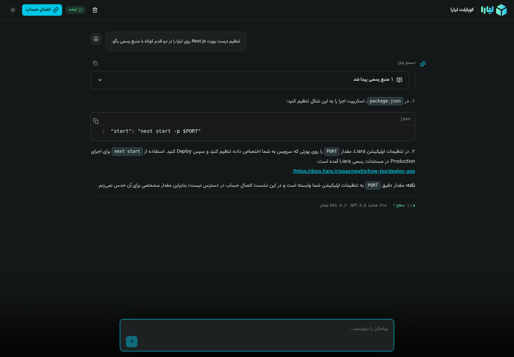

<p align="center">
  
</p>

<h1 align="center">Liara Copilot</h1>

<p align="center">
  A Persian-first AI agent for Liara documentation, cloud diagnostics, and safe infrastructure actions.
  <br />
  ایجنت فارسی لیارا برای مستندات، عیب‌یابی سرویس‌های ابری و اجرای امن عملیات زیرساختی.
</p>

<p align="center">
  <a href="https://liara-copilot-ir.liara.run"><strong>Live app · نسخهٔ آنلاین</strong></a>
  ·
  <a href="https://liara-copilot-ir.liara.run/api/health">Service health · وضعیت سرویس</a>
  ·
  <a href="docs/DEPLOYMENT.md">Deployment · استقرار</a>
</p>

<p align="center">
  <a href="#english">English</a>
  ·
  <a href="#فارسی">فارسی</a>
</p>

<p align="center">
  <a href="https://github.com/Hamidrezabayatdev/liara-copilot/actions/workflows/quality.yml">
    
  </a>
</p>



> Liara Copilot is an independent project and is not an official Liara product.
> این پروژه مستقل است و محصول رسمی لیارا نیست.

<a id="english"></a>

## English

Liara Copilot brings documentation search, live account inspection, diagnostics,
and infrastructure actions into one conversational interface. It can answer public
questions without an account. When a user connects their own Liara account, the
agent can inspect real resources and prepare explicitly approved changes.

### Highlights

- **Grounded answers:** searches a bundled snapshot of 1,125 official Liara
  documentation pages, applies adaptive hybrid retrieval with BM25, E5, and RRF,
  and links the sources used in each answer.
- **Live cloud context:** inspects connected apps, deployments, databases, disks,
  domains, logs, events, plans, and account details through allow-listed tools.
- **Multi-step diagnostics:** correlates configuration, runtime state, logs, and
  recent events instead of treating each signal in isolation.
- **Human-approved actions:** shows a before/after preview and requires a signed,
  user-specific confirmation before any supported write operation. Destructive
  `DELETE` operations are intentionally unavailable.
- **Cost-aware routing:** uses deterministic rules when possible, a lightweight
  router for ambiguous requests, Luna Pro for normal answers, and Gemini only for
  complex reasoning.
- **Conversation-focused UI:** streams Markdown, code, tables, links, sources, tool
  progress, and per-answer usage in a responsive Persian RTL interface.
- **Local persistence:** stores redacted conversation history in the browser and
  restores it after refresh without creating a server-side transcript database.

### Typical workflows

| You ask | Liara Copilot does |
|---|---|
| “How should I deploy Next.js securely on Liara?” | Searches official docs and returns a cited, actionable answer. |
| “Which apps are active in my account?” | Requests an account connection, then reads and summarizes live app state. |
| “Why is my API returning 502?” | Checks relevant configuration, deployment state, events, and logs to form a diagnosis. |
| “Set `APP_PORT` to `3000`.” | Prepares a change preview and waits for explicit approval before applying it. |
| A follow-up question | Reuses useful conversation context without resending unrelated data. |

### Model routing

| Role | Default model | When it runs |
|---|---|---|
| Router | `deepseek/deepseek-v4-flash` | Only when deterministic intent rules are not confident enough. |
| Answer | `openai/gpt-5.6-luna-pro` | Documentation answers, summaries, and ordinary tool-assisted requests. |
| Reasoning | `google/gemini-3.7-flash` | Complex diagnosis and multi-step reasoning. |

The enabled tool set and retrieved context are selected per request. Keyword search
is always available locally; semantic retrieval is invoked only when keyword
confidence is low, and at most four relevant sources enter the model context.

### Architecture

```text
Streaming Persian UI
  → deterministic-first intent routing
  → DeepSeek router / Luna Pro answer / Gemini reasoning
  → official-doc search or an explicit Liara capability set
       ├─ bundled docs: BM25 → conditional E5 + RRF
       └─ allow-listed Liara Management API client
  → projected and redacted tool results + sources + usage
  → browser-local conversation persistence
```

### Run locally

Requirements: Node.js 22+ and pnpm 9.

```bash
pnpm install --frozen-lockfile
cp .env.example .env
pnpm dev
```

Set `LIARA_AI_BASE_URL`, `LIARA_AI_KEY`, `TOOL_APPROVAL_SECRET`, and
`TOKEN_COOKIE_SECRET` in `.env`. The shared `LIARA_API_TOKEN` and
`LIARA_TEAM_ID` are optional and intended only for private development or smoke
tests. Public users connect their own accounts through the encrypted session flow.

See [.env.example](.env.example) for every setting and safe default.

### Quality checks

```bash
pnpm check       # lint + typecheck + unit/integration tests + production build
pnpm test:e2e    # desktop/mobile Chromium + streaming + keyboard + accessibility
```

To run the read-only Management API smoke test:

```bash
node scripts/test-liara-client.mjs
```

### Deployment and operations

The production app exposes a network-free `/api/health` endpoint and includes a
global request deadline, model-call budget, rate and concurrency guards, structured
telemetry, CSP, and HSTS. Telemetry records operational metadata, latency, model
usage, and cost—not prompts, responses, account tokens, cookies, or authorization
headers.

Follow [the Liara deployment guide](docs/DEPLOYMENT.md) for environment variables,
semantic-index generation, standard deployment, the standalone fallback, and
post-deployment checks.

### Security boundaries

- Connected account tokens are encrypted in an `HttpOnly` cookie with an
  eight-hour lifetime; they are not exposed to browser JavaScript or model context.
- Tool access is allow-listed per intent. Results are projected and redacted before
  they reach the model or browser.
- Every supported write requires a before/after preview, an HMAC-signed approval
  bound to the current user, and an explicit confirmation.
- Rate limits, approval replay protection, and circuit state are process-local in
  the current single-instance deployment and must move to a shared store before
  horizontal scaling.
- The semantic index must be rebuilt with `node scripts/build-docs-index.mjs`
  after changing the bundled documentation snapshot.

### Documentation

- [Architecture notes](docs/ARCHITECTURE-NOTES.md)
- [Deployment guide](docs/DEPLOYMENT.md)
- [Verified Liara API behavior](docs/VERIFIED-FACTS.md)
- [Product specification](docs/liara-agentic-assistant-product-spec-v2-en.md)

<a id="فارسی"></a>

## فارسی

Liara Copilot جست‌وجوی مستندات، مشاهدهٔ زندهٔ حساب، عیب‌یابی و عملیات
زیرساختی را در یک رابط مکالمه‌ای جمع می‌کند. پاسخ به پرسش‌های عمومی نیازی به
اتصال حساب ندارد. پس از اتصال حساب شخصی کاربر، ایجنت می‌تواند منابع واقعی را
بررسی کند و تغییرات را فقط با تأیید صریح او انجام دهد.

### قابلیت‌های اصلی

- **پاسخ مستند:** در نسخهٔ محلی ۱٬۱۲۵ صفحه از مستندات رسمی لیارا جست‌وجو
  می‌کند، نتیجه‌ها را با BM25، E5 و RRF به‌صورت تطبیقی بازیابی می‌کند و منبع
  هر پاسخ را نمایش می‌دهد.
- **اطلاعات زندهٔ زیرساخت:** برنامه‌ها، استقرارها، دیتابیس‌ها، دیسک‌ها، دامنه‌ها،
  لاگ‌ها، رویدادها، پلن‌ها و اطلاعات حساب متصل را با ابزارهای allow-list‌شده
  بررسی می‌کند.
- **عیب‌یابی چندمرحله‌ای:** تنظیمات، وضعیت اجرا، لاگ‌ها و رویدادهای اخیر را کنار
  هم تحلیل می‌کند تا به یک تشخیص کاربردی برسد.
- **عملیات با تأیید کاربر:** پیش از هر عملیات نوشتنی پشتیبانی‌شده، نمای
  قبل/بعد را نشان می‌دهد و منتظر تأیید امضاشده و مخصوص همان کاربر می‌ماند.
  عملیات مخرب `DELETE` عمداً در دسترس نیست.
- **مسیریابی بهینهٔ مدل:** تا جای ممکن از قواعد قطعی استفاده می‌کند؛ درخواست‌های
  مبهم را به router سبک، پاسخ‌های عادی را به Luna Pro و استدلال پیچیده را به
  Gemini می‌سپارد.
- **رابط مناسب مکالمه:** Markdown، کد، جدول، لینک، منابع، روند اجرای ابزار و
  مصرف هر پاسخ را به‌صورت streaming در رابط فارسی، RTL و responsive نمایش
  می‌دهد.
- **ماندگاری محلی:** تاریخچهٔ redacted گفتگو را داخل مرورگر نگه می‌دارد و بعد
  از refresh بازیابی می‌کند؛ transcript گفتگو روی سرور ذخیره نمی‌شود.

### کاربردهای رایج

| درخواست شما | رفتار Liara Copilot |
|---|---|
| «چطور Next.js را امن روی لیارا deploy کنم؟» | مستندات رسمی را جست‌وجو می‌کند و پاسخ مرحله‌ای همراه با منبع می‌دهد. |
| «کدام برنامه‌های حساب من فعال‌اند؟» | اتصال حساب را درخواست می‌کند و سپس وضعیت واقعی برنامه‌ها را می‌خواند و خلاصه می‌کند. |
| «چرا API من خطای ۵۰۲ می‌دهد؟» | تنظیمات مرتبط، وضعیت استقرار، رویدادها و لاگ‌ها را برای یافتن علت بررسی می‌کند. |
| «مقدار `APP_PORT` را روی `3000` بگذار.» | پیش‌نمایش تغییر را آماده می‌کند و تا تأیید صریح شما هیچ تغییری نمی‌دهد. |
| یک پرسش ادامه‌دار | context مفید گفتگو را حفظ می‌کند و دادهٔ نامرتبط را دوباره ارسال نمی‌کند. |

### مسیریابی مدل‌ها

| نقش | مدل پیش‌فرض | زمان استفاده |
|---|---|---|
| Router | `deepseek/deepseek-v4-flash` | فقط وقتی قواعد تشخیص intent اطمینان کافی ندارند. |
| پاسخ | `openai/gpt-5.6-luna-pro` | پاسخ مستندات، خلاصه‌سازی و درخواست‌های عادی همراه با ابزار. |
| استدلال | `google/gemini-3.7-flash` | عیب‌یابی پیچیده و فرآیندهای چندمرحله‌ای. |

ابزارها و context هر درخواست به‌صورت پویا انتخاب می‌شوند. جست‌وجوی کلیدواژه‌ای
همیشه به‌صورت محلی در دسترس است؛ semantic retrieval فقط وقتی اجرا می‌شود که
اطمینان جست‌وجوی اولیه پایین باشد و حداکثر چهار منبع مرتبط وارد context مدل
می‌شوند.

### معماری

```text
رابط فارسی با پاسخ streaming
  → تشخیص intent با اولویت قواعد قطعی
  → DeepSeek برای routing / Luna Pro برای پاسخ / Gemini برای استدلال
  → جست‌وجوی مستندات رسمی یا مجموعه ابزار مشخص لیارا
       ├─ مستندات محلی: BM25 → E5 و RRF شرطی
       └─ کلاینت allow-list‌شدهٔ Liara Management API
  → خروجی redacted ابزارها + منابع + میزان مصرف
  → نگه‌داری محلی گفتگو در مرورگر
```

### اجرای محلی

پیش‌نیازها: Node.js 22+ و pnpm 9.

```bash
pnpm install --frozen-lockfile
cp .env.example .env
pnpm dev
```

مقادیر `LIARA_AI_BASE_URL`، `LIARA_AI_KEY`، `TOOL_APPROVAL_SECRET` و
`TOKEN_COOKIE_SECRET` را در `.env` تنظیم کنید. متغیرهای مشترک
`LIARA_API_TOKEN` و `LIARA_TEAM_ID` اختیاری‌اند و فقط برای توسعهٔ خصوصی یا
smoke test در نظر گرفته شده‌اند. کاربران نسخهٔ عمومی حساب خودشان را با جریان
session رمزنگاری‌شده متصل می‌کنند.

همهٔ تنظیمات و مقدارهای پیش‌فرض امن در [.env.example](.env.example) توضیح داده
شده‌اند.

### بررسی کیفیت

```bash
pnpm check       # lint + typecheck + unit/integration tests + production build
pnpm test:e2e    # desktop/mobile Chromium + streaming + keyboard + accessibility
```

برای smoke test فقط‌خواندنی Management API:

```bash
node scripts/test-liara-client.mjs
```

### استقرار و عملیات

نسخهٔ production یک endpoint مستقل از شبکه در `/api/health` دارد و deadline
سراسری، سقف فراخوانی مدل، محدودیت نرخ و هم‌زمانی، telemetry ساختاریافته، CSP و
HSTS را پیاده‌سازی می‌کند. telemetry فقط metadata عملیاتی، latency، میزان مصرف
مدل و هزینه را ثبت می‌کند؛ prompt، پاسخ، token حساب، cookie و authorization
header ثبت نمی‌شوند.

برای متغیرهای محیطی، ساخت semantic index، استقرار استاندارد، fallback مستقل و
بررسی‌های پس از انتشار، [راهنمای استقرار روی لیارا](docs/DEPLOYMENT.md) را ببینید.

### مرزهای امنیتی

- token حساب متصل در cookie رمزنگاری‌شدهٔ `HttpOnly` با عمر هشت ساعت نگه‌داری
  می‌شود و در اختیار JavaScript مرورگر یا context مدل قرار نمی‌گیرد.
- دسترسی به ابزارها برای هر intent با allow-list محدود می‌شود و خروجی ابزارها
  پیش از رسیدن به مدل یا مرورگر، کوچک و redacted می‌شود.
- هر عملیات نوشتنی پشتیبانی‌شده به پیش‌نمایش قبل/بعد، تأیید HMAC متصل به کاربر
  فعلی و تأیید صریح او نیاز دارد.
- rate limit، جلوگیری از replay تأیید و circuit state در استقرار تک-instance
  فعلی process-local هستند و پیش از scale افقی باید به store مشترک منتقل شوند.
- پس از تغییر snapshot مستندات محلی باید semantic index با دستور
  `node scripts/build-docs-index.mjs` دوباره ساخته شود.

### مستندات

- [یادداشت‌های معماری](docs/ARCHITECTURE-NOTES.md)
- [راهنمای استقرار](docs/DEPLOYMENT.md)
- [رفتار تأییدشدهٔ API لیارا](docs/VERIFIED-FACTS.md)
- [مشخصات محصول](docs/liara-agentic-assistant-product-spec-v2-en.md)
